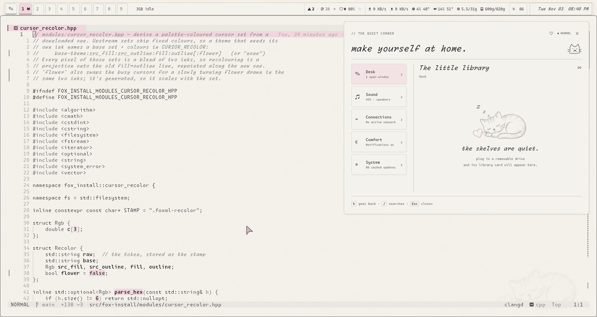
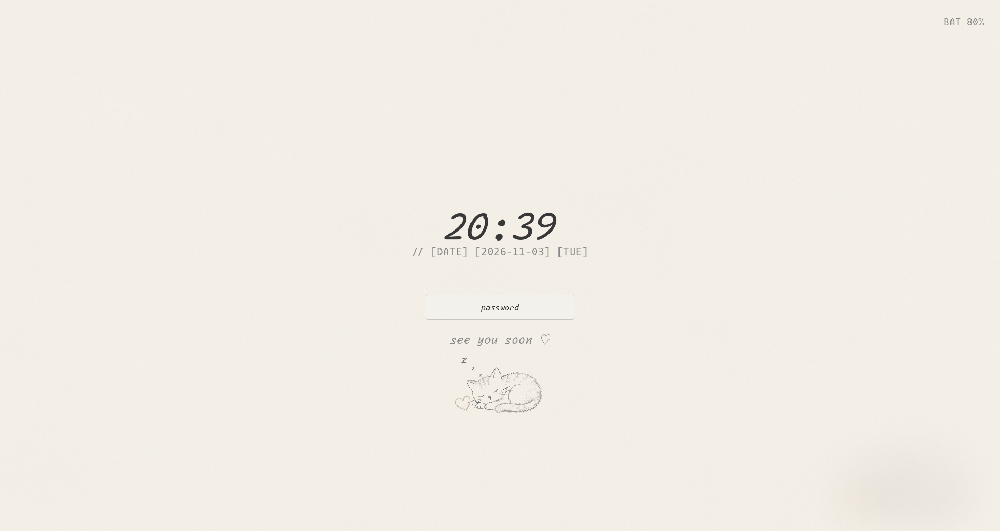
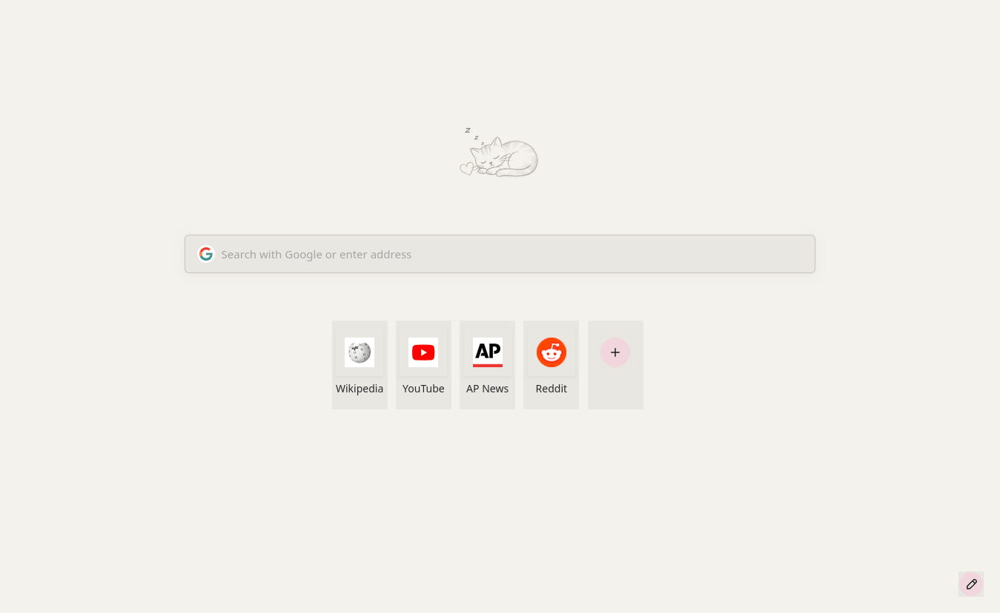
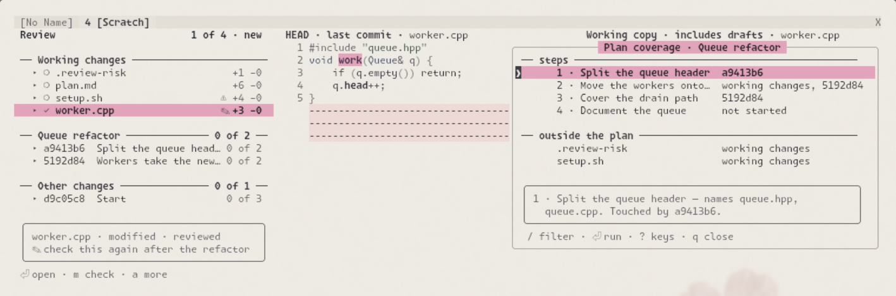
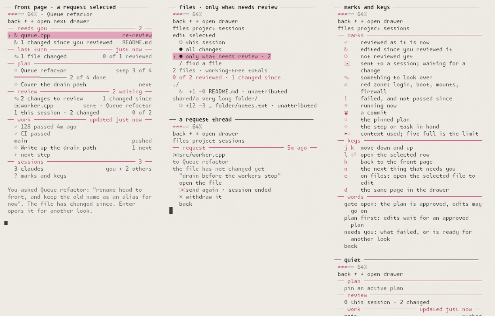

# Linux_Theme

An integrated desktop and workstation toolkit for **Arch Linux + Hyprland**.

Linux_Theme brings together desktop controls, coordinated application themes, system
setup, maintenance tools and optional local AI. This repository, `Linux_Theme`,
contains the configuration, installer and native tools that make it work.

[Install](#install) · [Themes](#themes) · [Everyday commands](#everyday-commands) · [Documentation](#documentation)

## What it includes

| Area | What you get |
| --- | --- |
| Desktop | Quickshell bar and drawers for apps, windows, audio, connections, projects and system controls |
| Themes | Shared palettes across terminals, editors, browsers, GTK/Qt apps, the lock screen and login screen |
| Setup | A modular C++ installer for packages, configuration, hardware and services |
| Maintenance | Desktop checks, system diagnostics, backups, update tools and recovery support |
| Development | Neovim, tmux and shell workflows, agent session status, job tracking, test results and a review of what an agent changed |
| Local AI | Optional model downloads and serving, coding agents, semantic search and diagnostic tools |
| Security | Configurable firewall, browser hardening, auditing and device controls |

Linux_Theme is an opinionated workstation setup built on Arch and Hyprland. Choose the
parts you want through the installer; the setup scripts provide broader defaults.

## Screenshots

The FoxML_Paper desktop, with its drawer open:



<details>
<summary>Lock screen, browser, terminal and editor</summary>






</details>

Reviewing what a coding agent changed, in Neovim: changes grouped by plan, before and after side by side, and each
plan step against the commits that touched it.



<details>
<summary>The Claude notebook</summary>

The pane beside a Claude Code session: what needs you, the last turn, the plan and the work, drawn here from sample
data by `python3 tests/notebook_preview.py`.



</details>

See [Agent workflows](docs/agent-workflows.md) for both.

## Install

Use an **Arch Linux system with Hyprland** and access to `sudo`. The installer can
install application dependencies and build tools. Allow space for kernel updates
and optional models; see the [requirements](docs/installation.md#requirements).

Clone the repository:

```bash
git clone https://github.com/Jennifer-214/Linux_Theme.git
cd Linux_Theme
```

Choose how much to install:

| Command | Use it for |
| --- | --- |
| `./install.sh` | An interactive wizard to choose modules and review the plan |
| `./setup-minimal` | Desktop themes and system packages, without the security, boot, login-screen or AI modules |
| `./setup` | The workstation defaults, plus packages, coding agents, model downloads and GitHub workspace cloning |

The two setup scripts pass `--yes` and apply their selected modules without the
wizard. They use your saved theme, or **FoxML_Classic** on a first install.
To choose another palette:

```bash
./setup-minimal FoxML_Paper
```

The full workstation setup changes system services and security settings as well
as desktop configuration. Use the interactive installer to review module choices.
See the [installation reference](docs/installation.md) for individual modules,
presets, dry-run plans, bootstrap installation and exit codes.

After installation, reload Hyprland and restart applications to load their new
configuration. Check the result with:

```bash
desk theme check
```

## Themes

**FoxML_Classic** is the maintained default: warm peach, dusty rose and sage on a
dark plum background. **FoxML_Paper**, shown above, uses light paper, graphite
text, blush accents and botanical illustrations.

Other palettes include Rose, Bubblegum, Cave Data Center and Amsterdam Orange.
Alternative themes have varying levels of completion; read the
[theme status and switching notes](themes/README.md).

```bash
./swap.sh                           # interactive theme picker
./install.sh FoxML_Classic --render # render, deploy and refresh a chosen theme
```

Edit files in `templates/` to keep changes across theme swaps. If you edited live
configs, `./update.sh` shows how they differ from the templates, to move by hand. See the
[theming guide](docs/theming.md) for application paths and capture limitations.

## Everyday commands

| Command or shortcut | What it opens or checks |
| --- | --- |
| `Alt+Space` | Find apps, windows, projects and desktop actions |
| `desktop-menu` | Desktop drawer |
| `desk sys cheatsheet` | Searchable keyboard shortcut reference |
| `desk theme check` | Deployed desktop configuration and runtime checks |
| `desk sys doctor` | Configuration diagnostics |
| `desk sec health` | Boot and authentication health checks |
| `desk sec dashboard` | Security dashboard |
| `desk monitor status` | Monitor layout status |
| `desk help` | Command namespaces and help |

See [KEYBINDS.md](KEYBINDS.md) for desktop shortcuts and the
[Neovim reference](shared/nvim_NVIM-KEYBINDS.md) for editor keys.

## Documentation

| Guide | Contents |
| --- | --- |
| [Installation](docs/installation.md) | Requirements, setup options, presets, module flags and first-run steps |
| [Desktop](docs/desktop.md) | Bar, drawers, search, projects, shell, editor, monitors and desktop checks |
| [Theming](docs/theming.md) | Palettes, application templates, configuration edits, fonts and new themes |
| [Agent workflows](docs/agent-workflows.md) | Claude notebook, session status, jobs, test results and review |
| [Local AI](docs/local-ai.md) | Coding agents, model roles, llama.cpp serving and semantic search |
| [Security tools](docs/security.md) | Hardening modules and everyday security commands |
| [Architecture](docs/architecture.md) | Rendering, deployment, native tools, builds and development |
| [Recovery](RECOVERY.md) | Troubleshooting authentication, firewall and access problems |
| [Security policy](SECURITY.md) | Threat model, secrets handling and vulnerability reporting |

## License

[MIT](LICENSE).
