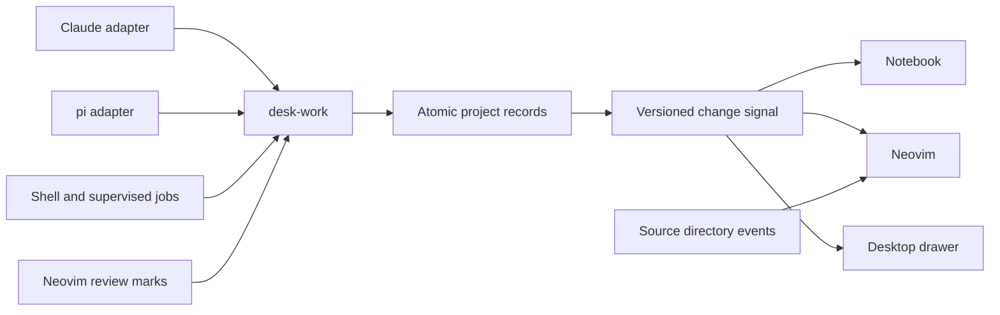

# Work integration audit

The work store owns project attention and action identity. Each app owns its presentation and local editor state.

| Area | Owner and integration |
| --- | --- |
| Attention priority and eligibility | `desk-work attention`; notebook and desktop consume it, Neovim can request a review-only projection |
| Action routing | `desk-work open --action attention` re-resolves the stable ID before acting; Neovim renders the same action in its existing windows |
| Work refresh | Successful record writes publish `revision.json`; `watch` streams invalidations, with polling for recovery |
| Agent identity and liveness | `desk-work agents`; kind plus session ID avoids collisions, process start identity avoids PID reuse |
| Claude engine state | Existing runtime hooks remain an adapter; newer needs-input, compaction and error state reaches the shared projection |
| Automatic job observation | Native `begin --safe yes` is the final policy check for Claude, pi and shell observers; client checks remain early hints |
| Unsaved editor state | Neovim owns buffers, baselines, undo and explicit merge decisions; a project signal never replaces unsaved text |
| Installation | Native mapping tables own assets; the deployment fixture discovers every Neovim and mod module and checks it is installed |
| Existing user menus | The native menu upgrade offers the new attention page once and preserves user roots, favorites and removed items |
| Event history and digest | One bounded journal, backend summaries and explicit per-consumer sequence cursors |
| Snoozing | Shared item fingerprints; a snooze changes visibility, never review or failure state |
| Relevant tests | Captured commands, working folders, freshness and explanation; the existing supervisor executes explicit reruns |
| Installed and loaded code | One native asset inventory, staged client stamps and a manifest; clients report what they loaded |
| Scoped update and rollback | The installer deployment/backup helpers, exact preview token and later-edit guards |
| Interrupted updates and cleanup | `desk-common/work_updates.hpp` owns transaction inventory and rollback-chain protection; the installer owns phase writes, recovery and previewed deletion |
| Refresh diagnostics | Clients report observations through `desk-work client-report`; native health projects loaded versions, connection and refresh times without publishing invalidations |
| Required checks | `tests/run_work_checks.py` is the local/CI runner; the verified SDK manifest owns engine/compiler pins and test declarations |
| Compatibility commands | The existing alias table; scoped updates replace old copies with canonical links and preserve custom aliases |
| Project resume | Native view records reference saved files; current buffers and terminal processes stay owned by Neovim |

Project preferences and `.fox-symdeps.json` remain untouched at the user's request. None of these integrations
requires symdeps. Presentation positions are not a replacement project configuration.

The installer entry exception was approved on 2026-11-13: a small early check reads the same native input-policy
table before the wrapper can mutate the installation. New deployment logic remains in the native module.

The scan also found intentional compatibility paths. The frozen shell mapping table remains for legacy capture;
new modules deploy through the native table and its tested exceptions. The drawer can still read old Claude files
when an older work backend is installed. Red-zone defaults exist in clients as fallbacks, with a parity test against
the canonical `shared/redzone.json`. These paths should shrink as compatibility is retired, rather than becoming
places to add new policy.

An agent's command timing alone cannot prove file authorship. The common registry attributes only explicit
write/edit observations. Claude's older shell-edit ledger remains a bounded heuristic for its turn receipts;
shared-file counts and test freshness describe the actual working tree.

The notebook's polling and change stream are independent of pane width. Compact mode remains compact while work
changes elsewhere. Notifications and state subscriptions do not send prompts to agents or restart their sessions.
